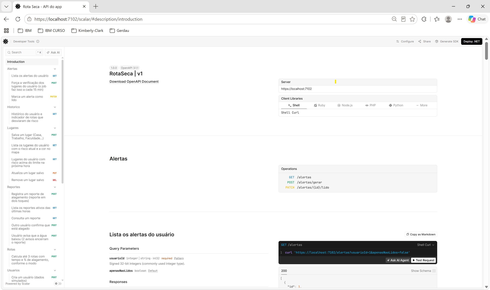
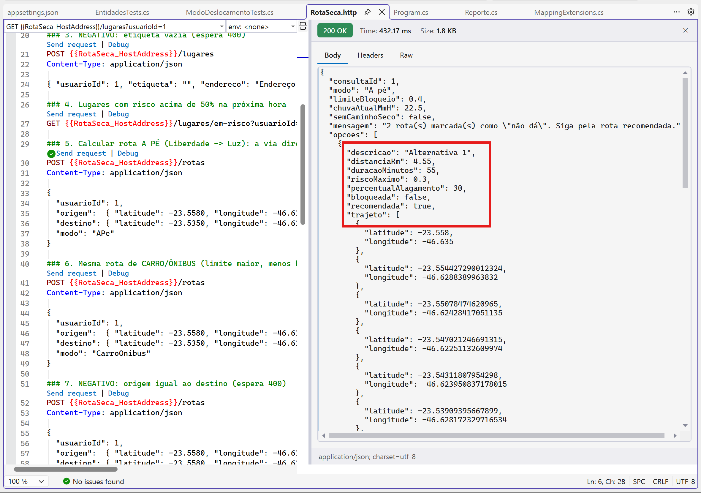
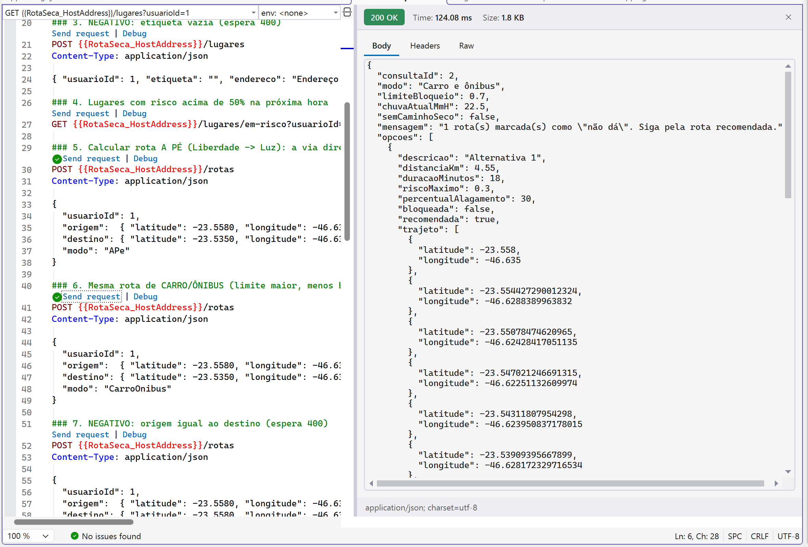
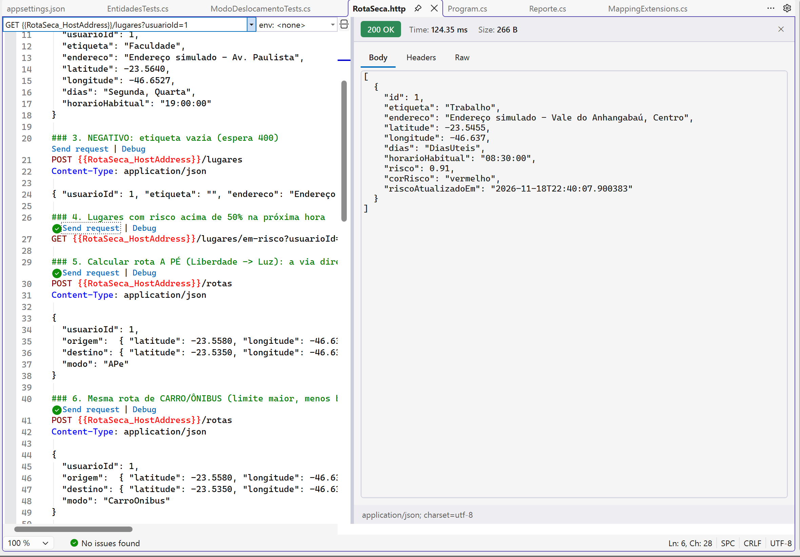
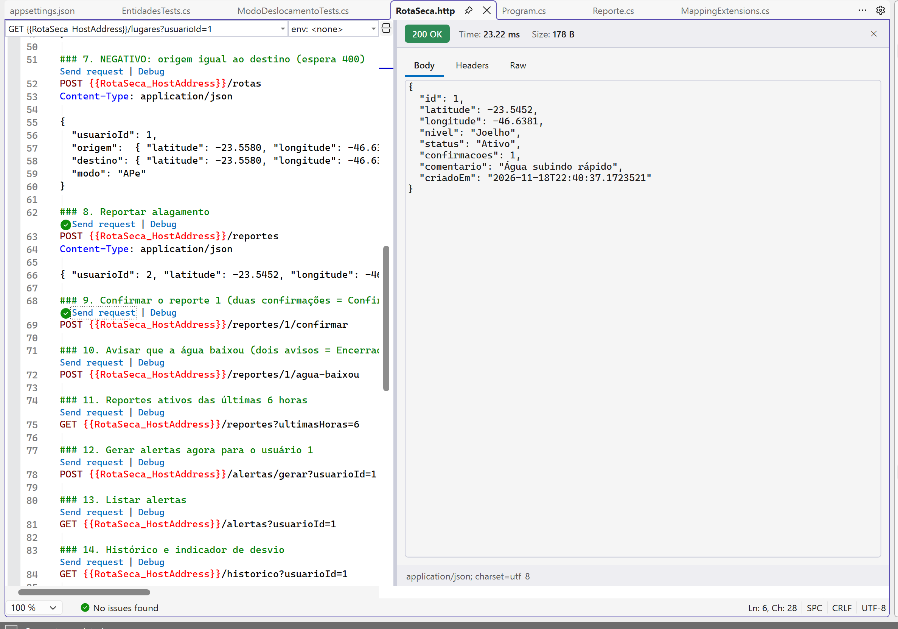
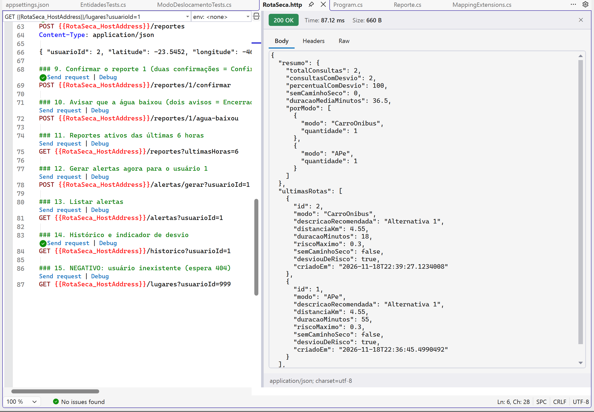
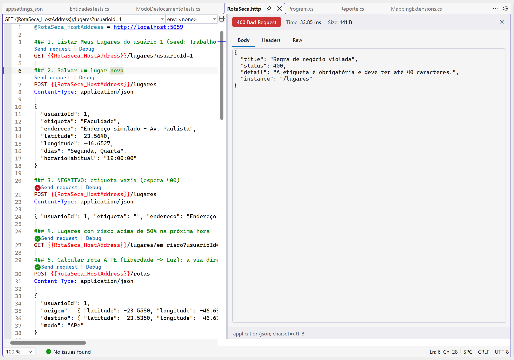
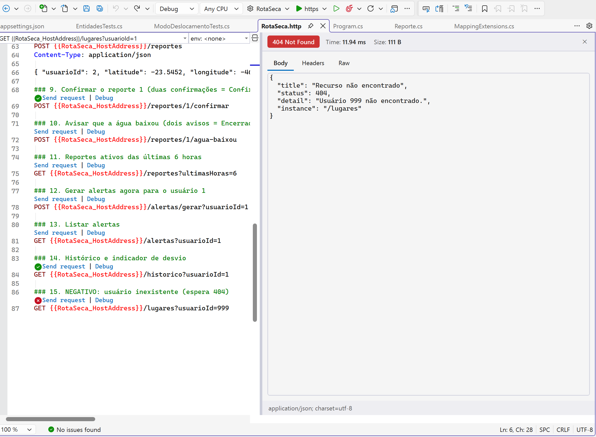

# Rota Seca — API do app (C# Software Development)

## Integrantes

- Camila Mie Takara RM555418
- Guilherme Barbiero RM555185
- Marco Antonio Gonçalves RM556818
- Mateus Cantiere RM558479
- Vinicius Castro RM556137

## Ficha da CitizenTech

| Campo | Conteúdo |
|---|---|
| Nome da CitizenTech | Rota Seca |
| Cidade e bairro | São Paulo, SP — região piloto com histórico de alagamento (Centro, nos dados simulados) |
| Cidadão beneficiado | Quem se desloca na chuva a pé, de moto, de bicicleta ou de ônibus, e quem mora em área de risco |
| Problema, em uma frase | Ninguém sabe, antes de sair de casa, se o caminho vai alagar: os mapas só mostram o alagamento depois que ele acontece, e o alerta oficial chega tarde e para a região inteira |
| Como funciona | Probabilidade de alagamento por trecho a cada 15 min, a partir da intensidade da chuva, do histórico, do relevo e dos relatos; alertas sobre os Meus Lugares e rotas que desviam da água em três modos (a pé, moto/bike, carro/ônibus) |
| O que cada parte faz | App (Mobile), API do app (C#), Serviço de Risco da Rua (SOA), modelo de probabilidade (ML), sensor de nível de água (IoT), infra Linux (OS), módulo PII (Cyber), Features e testes (Testing) |
| Link do repositório | https://github.com/SEU_USUARIO/SEU_REPOSITORIO |
| Indicador de impacto | % de rotas que desviaram de trecho com risco alto; acerto do modelo; minutos de antecedência do alerta |
| ODS conectados | 11 (11.5), 13 (13.1 e 13.3), 3 (3.9), 9 (9.1), 10 (10.2) |

## 1. Contextualização do problema

Em dias de chuva intensa, os cidadãos de São Paulo não dispõem de meios para saber,
antes de iniciar um deslocamento, se o trajeto pretendido estará alagado. Em geral, a
constatação ocorre apenas no local, quando a lâmina d'água já impede a passagem de
pedestres, provoca a pane de motocicletas ou interrompe a circulação do transporte
coletivo.

A dimensão do problema é expressiva. Em São Paulo, uma única tarde de chuva chegou a
registrar 78 pontos de alagamento (Poder360). Em âmbito nacional, as enchentes de 2024
no Rio Grande do Sul resultaram em 185 óbitos e afetaram aproximadamente 2,4 milhões de
pessoas (SBT News).

Observa-se que as informações necessárias para antecipar esses eventos já existem, porém
encontram-se dispersas entre diferentes órgãos. O Centro de Gerenciamento de Emergências
(CGE) publica os pontos de alagamento e sua transitabilidade; o INMET e o CEMADEN
monitoram a precipitação; e a Defesa Civil emite alertas por meio de *cell broadcast*.
Contudo, não há uma solução que integre esses dados no momento em que o cidadão decide
se e por onde se deslocar.

### 1.1 Limitações das soluções existentes

| Solução | Limitação identificada |
|---|---|
| Waze e Google Maps | Exibem o alagamento somente após o relato de um usuário, e as rotas continuam passando pelo trecho afetado |
| Defesa Civil Alerta | Emite alertas por região, e apenas em situação de risco iminente |
| Google Flood Hub | Prevê cheias de rios, sem granularidade em nível de via urbana |

Nenhuma das soluções analisadas combina previsão por trecho de via, cálculo de rota
alternativa e monitoramento dos locais frequentados pelo usuário.

### 1.2 Público beneficiado

- Pessoas que se deslocam a pé, de motocicleta, de bicicleta ou por transporte coletivo
- Moradores e trabalhadores de regiões de baixada e de áreas próximas a córregos
- Entregadores e motoristas de aplicativo, cuja atividade não é interrompida em dias de chuva
- Familiares de idosos residentes em áreas de risco

## 2. Proposta de solução: Rota Seca

> *"Rota Seca: saiba antes de sair se o caminho vai alagar."*

O Rota Seca é uma solução de mobilidade urbana que antecipa o risco de alagamento nos
locais frequentados pelo usuário e calcula rotas que evitam trechos com alta
probabilidade de alagamento. A cada 15 minutos, o sistema estima essa probabilidade para
cada trecho de via, a partir da integração de quatro camadas de informação:

1. **Intensidade da precipitação** (mm/h), medida e prevista: o alagamento decorre da concentração da chuva, e não do volume acumulado ao longo do dia;
2. **Histórico de alagamentos** registrado pelo CGE e pela Defesa Civil;
3. **Relevo e drenagem**, considerando baixadas, fundos de vale e proximidade de cursos d'água;
4. **Relatos em tempo real** de usuários e medições de sensores de nível de água (ESP32).

### 2.1 Funcionalidades

**Meus Lugares.** O usuário cadastra endereços de interesse com uma etiqueta (por
exemplo, Casa, Trabalho ou Faculdade) e, opcionalmente, os dias e horários de
frequência. O sistema monitora a precipitação nesses pontos e emite alertas antecipados
quando a probabilidade de alagamento ultrapassa 50%.

**Cálculo de rota segura.** A partir da origem, do destino e do modo de deslocamento
informados, o sistema apresenta até três rotas, cada uma com o tempo estimado e a
probabilidade de alagamento. As rotas que excedem o limite de segurança são sinalizadas
como indisponíveis, e a rota mais segura é destacada como recomendada.

**Limites de segurança por modo de deslocamento.** O sistema adota um único motor de
rotas, e cada modo altera apenas o limite de risco aceito:

| Modo de deslocamento | Bloqueio a partir de | Justificativa |
|---|---|---|
| A pé | 40% | Uma lâmina d'água de 15 a 20 cm pode derrubar uma pessoa e ocultar bueiros abertos |
| Motocicleta e bicicleta | 50% | Há risco de pane no motor e de perda de aderência mesmo em lâminas d'água reduzidas |
| Carro e ônibus | 70% | Toleram lâminas d'água maiores, mas permanecem suscetíveis a arrasto em alagamentos severos |

Os limites constituem parâmetros iniciais e serão calibrados na etapa de testes.

**Reporte colaborativo.** O usuário que se depara com um alagamento pode registrá-lo em
duas interações, informando o nível da água. O reporte passa a integrar o mapa
compartilhado, é considerado confirmado após a validação de outros usuários e é
encerrado quando dois usuários informam que a água baixou.

**Histórico e indicadores.** O sistema registra as consultas de rota realizadas e
calcula indicadores de impacto, como o percentual de rotas que desviaram de trechos de
alto risco.

## 3. Escopo desta API

Este repositório contém a API do aplicativo, desenvolvida em C#/.NET, que constitui a
camada de backend consumida pelo aplicativo móvel. A API não realiza a previsão
meteorológica nem o treinamento do modelo preditivo. Sua responsabilidade é orquestrar
os componentes do Rota Seca e aplicar as regras de negócio da solução.

```
Aplicativo Rota Seca (Mobile)
          │
          ▼
API do aplicativo (C#/.NET)  ─────►  Serviço de Risco da Rua (SOA)
  • usuários e Meus Lugares             • probabilidade por trecho (modelo de ML)
  • cálculo de rota por modo            • precipitação atual (Open-Meteo, INMET)
  • reportes e confirmações             • pontos de alagamento (CGE)
  • alertas automáticos (15 min)        • leituras do sensor de nível (ESP32)
  • histórico e indicadores
```

A integração com os serviços externos é realizada por meio de interfaces
(`IRiscoProvider`, `IChuvaProvider` e `IRoteadorProvider`) registradas por injeção de
dependência. Enquanto o Serviço de Risco da Rua não estiver disponível, a API utiliza
provedores simulados que respeitam o mesmo contrato. A substituição pelo serviço real
exige apenas a alteração do arquivo `appsettings.json`, sem impacto nas regras de negócio.

### 3.1 Fluxo de cálculo de rota

1. O aplicativo envia a origem, o destino e o modo de deslocamento (`POST /rotas`).
2. A API solicita as rotas candidatas ao roteador e, de forma concorrente, consulta a precipitação atual.
3. Para cada rota, a API consulta de forma concorrente a probabilidade de alagamento de todos os pontos do trajeto e considera o maior valor obtido.
4. A estratégia correspondente ao modo de deslocamento (`APe`, `MotoBike` ou `CarroOnibus`) determina se a rota deve ser bloqueada.
5. Dentre as rotas não bloqueadas, é recomendada a de menor risco; em caso de empate, a de menor duração.
6. A consulta é persistida no histórico para compor os indicadores de impacto.
7. Caso todas as rotas estejam bloqueadas, a API informa a inexistência de caminho seguro e orienta o usuário a aguardar a redução da chuva, sem indicar trajetos sujeitos a alagamento.

## 4. Privacidade e proteção de dados

Em conformidade com a Lei Geral de Proteção de Dados (LGPD), os endereços cadastrados em
Meus Lugares, as rotas individuais e os horários de deslocamento dos usuários não são
compartilhados fora desta API. Apenas a informação agregada por trecho de via, como a
probabilidade de alagamento, é disponibilizada para o mapa público.

Nenhum dado pessoal real foi utilizado no desenvolvimento deste projeto. Usuários,
endereços e reportes são simulados, e as coordenadas dos pontos críticos correspondem a
localizações aproximadas da região central de São Paulo.

## 5. Contribuição para os Objetivos de Desenvolvimento Sustentável

| ODS | Meta | Contribuição do Rota Seca |
|---|---|---|
| 11 – Cidades e comunidades sustentáveis | 11.5 – Reduzir mortes e pessoas afetadas por desastres, inclusive os relacionados à água | Retira pessoas do trajeto da água antes do alagamento e disponibiliza o mapa de risco à cidade |
| 13 – Ação contra a mudança global do clima | 13.1 – Resiliência a riscos climáticos; 13.3 – Alerta precoce | Adapta a rotina urbana a chuvas mais intensas, com alertas antecipados por local |
| 3 – Saúde e bem-estar | 3.9 – Reduzir doenças por contaminação | Reduz o contato com águas de enchente, vetor de transmissão da leptospirose |
| 9 – Indústria, inovação e infraestrutura | 9.1 – Infraestrutura resiliente | Fornece um ranking de pontos críticos para priorização de obras de drenagem |
| 10 – Redução das desigualdades | 10.2 – Inclusão de todos | Adota limites mais rigorosos para pedestres e prioriza bairros de baixada |

## 6. Indicadores de impacto

- Percentual de rotas que desviaram de ao menos um trecho de alto risco (disponível em `GET /historico`);
- Taxa de acerto do modelo: alertas confirmados por relato ou pelo CGE em relação ao total de alertas emitidos;
- Antecedência, em minutos, entre o alerta emitido pelo sistema e o primeiro registro oficial do alagamento;
- Acréscimo médio de tempo da rota segura em relação à rota padrão;
- Percentual de reportes confirmados por um segundo usuário.

## 7. Arquitetura e tecnologias

**Stack:** .NET 10 · ASP.NET Core Web API · Entity Framework Core · SQLite · Scalar (OpenAPI) · xUnit · Moq

```
Controllers  →  Services  →  Repositories (EF Core)  →  SQLite
                   │
                   └──→  Integrations (IRiscoProvider, IChuvaProvider, IRoteadorProvider)
```

| Conceito | Onde está aplicado |
|---|---|
| **Programação Orientada a Objetos** | `EntidadeBase` abstrata com herança; encapsulamento por setters privados e métodos com regras de negócio (`Confirmar`, `RegistrarQueAguaBaixou`, `RegistrarRisco`); `Validar()` sobrescrito em cada entidade; objeto de valor imutável `Coordenada` |
| **Polimorfismo (Strategy)** | `IModoDeslocamento` com as implementações `APe`, `MotoBike` e `CarroOnibus`, cada uma com seu limite de bloqueio; `CarroOnibus` sobrescreve o cálculo de duração |
| **Interfaces e Injeção de Dependência** | Todos os serviços, repositórios e provedores são registrados no `Program.cs` e recebidos pelo construtor; o provedor de risco (simulado ou HTTP) é escolhido pelo `appsettings.json` |
| **Entity Framework Core** | `AppDbContext`, configurações via Fluent API (`Data/Configurations`), migrations versionadas, dados iniciais (seed) e validação das entidades no `SaveChangesAsync` |
| **LINQ** | Consultas com `Where`, `OrderBy`, `GroupBy`, `Count`, `Average`, `Any`, `Include` e `Take` nos repositórios; seleção da rota recomendada com `Where`/`OrderBy`/`ThenBy` |
| **Programação assíncrona** | Todas as camadas `async`/`await` com `CancellationToken`; `Task.WhenAll` para consultar riscos em paralelo; `BackgroundService` com `PeriodicTimer` gerando alertas a cada 15 minutos |
| **API REST** | 6 controllers, DTOs de entrada e saída, status HTTP adequados (200, 201, 204, 400, 404, 503) e tratamento global de erros no padrão `ProblemDetails` |
| **Testes unitários** | Projeto `RotaSeca.Tests` com 27 testes (xUnit + Moq) cobrindo entidades, estratégias de deslocamento e serviços |

### Estrutura de pastas

```
RotaSeca/
├─ BackgroundJobs/   job de alertas a cada 15 minutos
├─ Controllers/      endpoints REST
├─ Data/             DbContext e configurações do EF Core
├─ Domain/           entidades, enums, exceções, objetos de valor e estratégias de modo
├─ DTOs/             contratos de entrada e saída da API
├─ Integrations/     interfaces e provedores (simulados e HTTP)
├─ Mappings/         conversão de entidades para DTOs
├─ Middlewares/      tratamento global de exceções
├─ Migrations/       migrations do EF Core
├─ Repositories/     acesso a dados com LINQ
└─ Services/         regras de aplicação
RotaSeca.Tests/      testes unitários
evid/                evidências de funcionamento
```

## 8. Como executar

### Pré-requisitos
- .NET 10 SDK
- Visual Studio 2022 (17.13 ou superior) ou Visual Studio 2026

### Pelo Visual Studio
1. Clone o repositório e abra o arquivo `RotaSeca.slnx`.
2. Pressione `Ctrl+F5` (Iniciar sem Depuração). O banco SQLite é criado automaticamente na primeira execução, com dados iniciais simulados.
3. A documentação dos endpoints abre no navegador em `https://localhost:<porta>/scalar`.
4. As requisições de exemplo estão no arquivo `RotaSeca/RotaSeca.http`. Ajuste a porta na primeira linha, se necessário.
5. Para rodar os testes: **Teste → Executar Todos os Testes**.

### Pela linha de comando
```bash
dotnet run --project RotaSeca
dotnet test
```

## Endpoints
| Método | Rota | Descrição |
|---|---|---|
| POST | /lugares | Salva um lugar |
| GET | /lugares?usuarioId= | Lista lugares com o risco atual |
| GET | /lugares/em-risco?usuarioId=&limite= | Lugares com risco ≥ limite na próxima hora |
| PUT | /lugares/{id} | Atualiza um lugar |
| DELETE | /lugares/{id} | Remove um lugar |
| POST | /rotas | Calcula até 3 rotas (origem, destino, modo) |
| POST | /reportes | Reporta alagamento |
| GET | /reportes | Reportes ativos |
| POST | /reportes/{id}/confirmar | Confirma um reporte |
| POST | /reportes/{id}/agua-baixou | Avisa que a água baixou |
| GET | /alertas?usuarioId= | Lista alertas |
| POST | /alertas/gerar?usuarioId= | Força a verificação de alertas |
| GET | /historico?usuarioId= | Histórico e indicador de impacto |
| POST / GET | /usuarios | Cria e consulta usuários |

## Evidências de funcionamento

As evidências abaixo foram geradas com a API em execução local, a partir das requisições
do arquivo `RotaSeca/RotaSeca.http`. Todos os dados utilizados são simulados.

### 1. Documentação dos endpoints (Scalar)
A documentação interativa é gerada automaticamente a partir do OpenAPI e fica disponível
em `/scalar` ao executar a aplicação.



### 2. Cálculo de rota no modo a pé
Requisição `POST /rotas` com o modo `APe`. Como o limite de bloqueio para pedestres é 40%,
a via direta, que passa próxima ao Vale do Anhangabaú, é marcada como bloqueada, e o
sistema recomenda a alternativa de menor risco.



### 3. Mesma rota no modo carro/ônibus
O mesmo trajeto, calculado com o modo `CarroOnibus` (limite de 70%), apresenta menos
bloqueios. Isso evidencia o polimorfismo da estratégia `IModoDeslocamento`: a mesma
probabilidade de alagamento leva a decisões diferentes conforme o modo de deslocamento.



### 4. Lugares com risco acima de 50% na próxima hora
Requisição `GET /lugares/em-risco`. A API atualiza o risco de cada lugar salvo de forma
concorrente (`Task.WhenAll`) e filtra no banco, via LINQ, apenas os lugares cujo risco é
igual ou superior ao limite informado.



### 5. Reporte de alagamento confirmado por outros usuários
Um reporte criado por `POST /reportes` passa ao status `Confirmado` após duas
confirmações (`POST /reportes/{id}/confirmar`), regra implementada na própria entidade
`Reporte`.



### 6. Histórico e indicador de impacto
Requisição `GET /historico`. O resumo é calculado com consultas LINQ (`Count`, `GroupBy`
e `Average`) e apresenta o percentual de rotas que desviaram de trechos de alto risco,
indicador de impacto definido na Ficha da CitizenTech.



### 7. Tratamento de erro: requisição inválida (400)
O cadastro de um lugar com etiqueta vazia viola uma regra de domínio. O tratamento global
de exceções converte a `DomainException` em uma resposta `400 Bad Request` no padrão
`ProblemDetails`.



### 8. Tratamento de erro: recurso inexistente (404)
A consulta a um usuário inexistente gera uma `NotFoundException`, convertida em
`404 Not Found`.



### 9. Testes unitários
O projeto `RotaSeca.Tests` reúne 27 testes (xUnit + Moq), que cobrem as regras das
entidades, as estratégias de modo de deslocamento e os serviços de rota e de alertas,
com os provedores externos e os repositórios substituídos por mocks.


